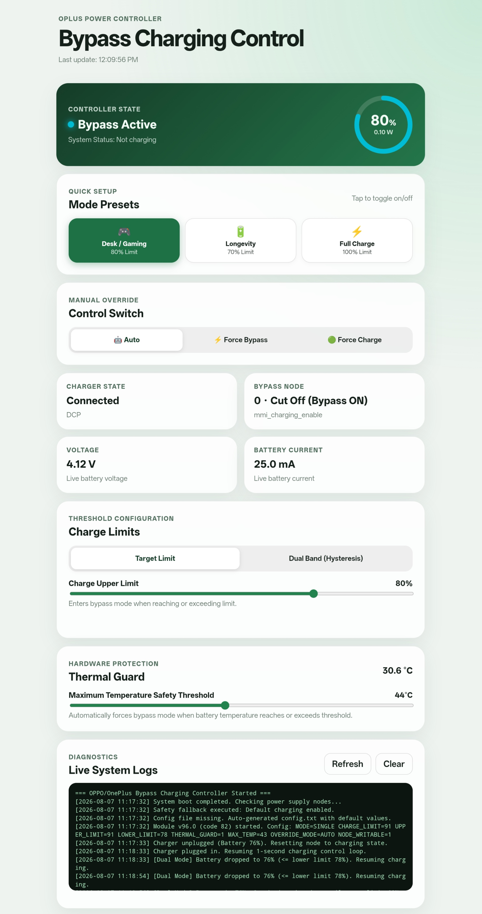

# ⚡ OnePlus / OPPO Bypass Charging Controller (oplusPowerController)

[](module.prop)
[](module.prop)
[](META-INF/com/google/android/update-binary)

An advanced, hardware-level battery management and bypass charging module engineered for **OnePlus Pad 2 Pro (sm8750)** and compatible **OPPO / OnePlus / Realme (OPlus)** devices running **KernelSU**, **KernelSU Next**, **APatch**, or **Magisk**.

It isolates battery charging at user-defined capacity limits while supplying power directly to the device motherboard from the external charger, reducing heat generation and extending long-term battery lifespan.

<p align="center">
  
</p>

---

## 🛠️ Hardware Driver Architecture & Power Nodes

This module targets the single verified charging arbitration voter node on the **OnePlus Pad 2 Pro (sm8750)** `oplus_chg v2` driver (`vendor/oplus/kernel/charger/v2/oplus_configfs.c`):

* **Bypass / Charging Control Node**:
  `/sys/devices/virtual/oplus_chg/battery/mmi_charging_enable`
  *(Writes to this node interface directly with the kernel's `chg_disable_votable` arbitration system via `MMI_CHG_VOTER`)*
* **Post-Write Hardware Verification**: `set_charging_state()` writes `0` (bypass/hold) or `1` (allow charging) and reads back the node value to verify that the hardware write took effect.
* **Strict Node Validation**: `required_power_nodes_available()` requires that `BYPASS_NODE` is writable, `CAPACITY_NODE` is readable, and `USB_ONLINE_NODE` is readable before allowing automation to run.

---

## ✨ Features & Hardware Protection Mechanisms

### 🔄 Flexible Charge Control Modes
* **Single Target Limit Mode**: Cuts off charging when battery capacity reaches `CHARGE_LIMIT` (default 91%).
* **Dual Band Hysteresis Mode**: Configures an `UPPER_LIMIT` (default 91%) and `LOWER_LIMIT` (default 78%). When battery reaches the upper limit, charging stops and bypass mode is held until capacity drops to the lower limit before resuming charging.
* **Plug-In Hysteresis Logic**: When plugging in at a capacity between lower and upper limits (e.g. 90%), bypass mode is immediately activated unless the device was actively charging up from below the lower limit.

### 🛡️ Safety & Stability Features
* **Minimum Band Gap (`MIN_BAND_GAP=5%`)**: `normalize_dual_limits()` enforces at least 5% separation between `UPPER_LIMIT` and `LOWER_LIMIT` across WebUI, CLI, and `config.txt` to prevent fuel gauge reading jitter from rapidly cycling the charging IC.
* **Chatter Guard Dwell Timer (`MIN_DWELL_SECONDS=15s`)**: Automatic capacity-threshold transitions (`apply_auto_transition`) require at least 15 seconds between automatic flips. Manual overrides, thermal guard, unplug, and config updates react instantly.
* **Thermal Guard Protection (`THERMAL_HYSTERESIS=2°C`)**: Forces bypass mode when battery temperature reaches or exceeds `MAX_TEMP` (default 43°C, range 25–60°C). Requires temperature to drop 2°C below `MAX_TEMP` before releasing to prevent boundary flicker.
* **Sensor Sanity Check**: Validates `is_percentage "$CAPACITY"`. Glitched or unreadable sensor values ("N/A") freeze state without misfiring.
* **Boot State Seeding**: Seeds `LAST_STATE` from actual hardware node state on boot to prevent relay clicks between lower and upper limits.

### 🌐 WebUI Dashboard & Controls
* **Live Circular SVG Power Gauge**: Real-time capacity %, live wattage (W), voltage (V), current (mA), battery temperature (°C), charger type, and USB connection status.
* **1-Tap Controls & Instant Auto-Save**: Mode tabs, manual override switches, and presets execute `saveConfigImmediate()` instantly without waiting for slider debounces. Polling protection prevents background refresh from overwriting user selections.
* **Quick Presets**: Instant chips for **Desk / Gaming** (80%), **Longevity** (70%), and **Full Charge** (100%), with tap-to-toggle off capability and solid white deactive styling.
* **Integrated Live Log Viewer**: View, refresh, and clear system logs directly inside WebUI (`get-log.sh`, `clear-log.sh`).

### 🔘 Module Action Script (`action.sh`)
* Trigger via KernelSU, KernelSU Next, or APatch **Action button** on the module card (or run `su -c /data/adb/modules/oplusPowerController/action.sh`) to instantly toggle between **Forced Charge Mode** and **Auto Control Mode**.

---

## ⚙️ Configuration Reference (`config.txt`)

Stored at `/data/adb/modules/oplusPowerController/config.txt` and generated automatically if missing:

```ini
MODE=SINGLE           # Control mode: SINGLE or DUAL
CHARGE_LIMIT=91       # Single limit target percentage (0-100%)
UPPER_LIMIT=91        # Dual band upper limit (cuts charging)
LOWER_LIMIT=78        # Dual band lower limit (resumes charging)
THERMAL_GUARD=1       # Thermal guard safety: 1 (Enabled) or 0 (Disabled)
MAX_TEMP=43           # Thermal guard threshold temperature in °C (25-60°C)
OVERRIDE_MODE=AUTO    # Manual override mode: AUTO, FORCE_BYPASS, or FORCE_CHARGE
```

Adjustments can also be passed directly to `set-config.sh`:
```sh
su -c "/data/adb/modules/oplusPowerController/set-config.sh MODE=DUAL UPPER_LIMIT=90 LOWER_LIMIT=80"
```

---

## 💡 Status Badges (`module.prop`)

The `module.prop` description updates atomically via `printf` whenever status or configuration changes:

* 🟢 **Normal Charging**: Standard charging allowed up to target limit.
* ⚡ **Bypass Active**: Hardware bypass active; battery charging isolated.
* 🛡️ **Thermal Guard Active**: Forced bypass due to high battery temperature (>= `MAX_TEMP`).
* ⚡ **Forced Bypass ON**: Manual override forced bypass mode.
* 🟢 **Forced Charge ON**: Manual override forced charging mode.
* 💤 **Unplugged**: Charger disconnected; module in standby.
* 🔴 **Module Disabled**: Module disabled or marked for removal.
* ❌ **Device Unsupported**: Required kernel nodes missing or unwritable.
